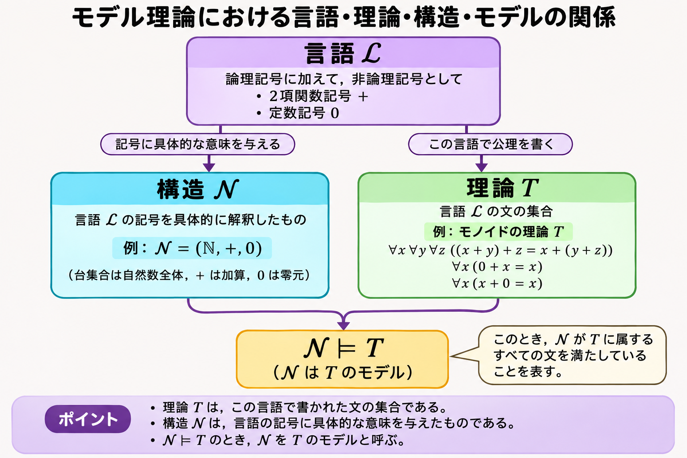

# 本章の流れ

本書では、代数的エフェクトとハンドラーの数学的な理論を説明していきます。

その中では、代数理論、演算、等式、モデル、自由モデルといった概念が登場します。

これらの言葉は、普遍代数学や数理論理学でも使われており、もともとは馴染みのある数学的な考え方と結び付いています。

一方、代数的エフェクトの主要論文では、これらの概念が圏論によって定式化されています。

例えば、代数理論を有限積を持つ小圏として定義し、そのモデルを有限積保存関手として定義します。

これだけを聞くと、普段「理論」や「モデル」という言葉から想像するものとは、ずいぶん違って感じられるかもしれません。

しかし、これらは無関係な概念に同じ名前を付けたものではありません。

演算とそれらが満たす法則を考え、その法則を満たす具体的な構造を考えるという基本的な発想が、圏論の言葉によって捉え直されているのです。

本章では、まずモデル理論における理論とモデルの基本的な考え方を確認します。次に普遍代数学へ進み、演算と等式によって代数的構造を記述する方法を説明します。

最後に、これらの概念が圏論ではどのように表現されるのかを説明します。

# 理論とモデル：モデル理論の見方

最初に、「理論」と「モデル」という言葉について考えてみましょう。

数学では、何らかの法則や公理を定め、それらが成り立つ対象を研究することがあります。

例えば、ある演算が結合律や単位元の法則を満たすことを要求し、そのような演算を持つ数学的な構造について調べることができます。

このような、数学的な法則と、それを満たす構造との関係を研究する分野の一つが、**モデル理論（model theory）** です。モデル理論は、数学で使われる論理や推論の仕組みを研究する数理論理学の一分野です。

モデル理論では、まず使用する記号と、それらを組み合わせて数学的な主張を記述するための規則を定めます。これを **言語（language）** と呼びます。

その言語を使って数学的な性質を表す式を記述します。

こうした式のうち、変数の値を別に指定する必要がなく、解釈する構造が決まれば真偽が定まるものを **文（sentence）** と呼びます。

そして、ある言語で書かれた文の集合を **理論（theory）** として扱います。

一方、言語に登場する記号に具体的な意味を与えた数学的な構造を考えます。

その構造において理論に属するすべての文が成り立つとき、その構造を理論の **モデル（model）** と呼びます。

## 【例】モノイド

理論とモデルの関係を、モノイドという代数的構造を使って考えてみましょう。

モノイドとは、集合と、その集合上の二項演算および単位元を備えた構造で、結合律と単位元の法則を満たすものです。

二項演算とは、二つの値を受け取って一つの値を返す演算のことです。

モノイドを記述するために、二項演算を表す記号 $\cdot$ と、単位元を表す記号 $e$ を使います。

これらの記号を使って、次の法則を記述できます。

結合律：

$$
\forall x\,\forall y\,\forall z\;
((x\cdot y)\cdot z=x\cdot(y\cdot z))
$$

単位元の法則：

$$
\forall x\;(e\cdot x=x\land x\cdot e=x)
$$

ここで、$\forall$ は「すべての」、$\land$ は「かつ」を意味する記号です。

つまり、これらは、どのような元についても結合律と単位元の法則が成り立つことを要求しています。

この二つの文からなる集合を、モノイドの理論 $T$ として考えます。

では、そのモデルとは何でしょうか。

例えば、自然数の集合 $\mathbb N$ を考え、二項演算記号 $\cdot$ を自然数の加算 $+$、単位元の記号 $e$ を $0$ として解釈します。

すると、

$$
\mathcal N=(\mathbb N,+,0)
$$

という構造が得られます。

自然数の加算は結合律を満たし、$0$ は加算の単位元です。

したがって、$\mathcal N$ は理論 $T$ のすべての文を満たします。

この関係を、

$$
\mathcal N\models T
$$

と表します。

ここで $\models$ は、左側の構造が右側の理論を満たすことを表す記号です。

つまり、理論では演算の具体的な意味を決めずに法則を記述し、モデルでは演算に具体的な意味を与え、その法則が成り立つことを確認するわけです。

## ここまでのまとめ

モデル理論では、数学的な性質を記述するための言語を定め、その言語で書かれた文の集合を理論として扱います。

一方、言語に登場する記号に具体的な解釈を与えたものが構造です。その構造において、理論に属するすべての文が成り立つとき、その構造を理論のモデルと呼びます。

モノイドの例を使って、これらの関係を図にまとめると次のようになります。なお、図では演算記号を $\cdot,e$ ではなく $+,0$ と表記しています。

ここで重要なのは、**理論が要求する性質と、それを満たす具体的な構造を区別している**ということです。

また、理論と構造のどちらから考え始めても構いません。理論が先にあって、それを満たす構造を探すことも、具体的な構造から出発して、そこで成り立つ性質を調べることもできます。

モデル理論では、こうした関係を基礎として、どのようなモデルが存在するのか、異なるモデルにはどのような性質が共通するのか、といった問題も研究します。

次に、普遍代数学を見ていきます。普遍代数学では、特に演算とそれらが満たす等式に注目し、代数的構造に共通する性質を研究します。

# 普遍代数学における理論とモデル

次に、普遍代数学（universal algebra）について見ていきます。

普遍代数学は、モノイド、群、環などの代数的構造に共通する性質を抽出し、それらを統一的に扱う数学の分野です。

モデル理論では、演算に限らず、対象の間の関係や、さまざまな数学的性質を記述できます。

一方、古典的な普遍代数学では、主に **演算と、それらの演算が満たす等式** に注目します。

そして、個々の代数だけでなく、演算を保つ写像や、代数から別の代数を作る構成などについても研究します。

本書では普遍代数学そのものを体系的に学ぶわけではありません。後に登場する圏論的な定義を理解するために、必要な概念を確認します。

## 演算

数学における **演算（operation）** とは、与えられた対象から新しい対象を得る操作のことです。

例えば、自然数の加算

$$
+:\mathbb N\times\mathbb N\to\mathbb N
$$

は、二つの自然数を受け取って一つの自然数を返す演算です。

まず、入力の数が有限個である演算を考えます。

集合 $A$ 上の $n$ 項演算（$n$-ary operation）とは、写像

$$
f:A^n\to A
$$

のことです。

ここで $A^n$ は $A$ の $n$ 個の直積を表します。

この $n$ を演算の **アリティ（arity）** と呼びます。

加算や乗算は2項演算、符号反転は1項演算です。また、0項演算は $A^0$ が一元集合であることから、$A$ の元を一つ指定することに相当します。したがって、定数も演算の一種として扱います。

ここで重要なのは、**演算そのものと演算を表す記号を区別すること**です。

例えば、記号 $+$ だけでは、自然数の加算なのか、整数の加算なのか、別の構造上の演算なのかは決まりません。

同じ演算記号であっても、それをどの集合上でどのような写像として解釈するかによって、具体的な演算は異なります。

なお、本章では有限アリティの演算を扱いますが、代数的エフェクトの理論では無限集合をアリティとする演算も考えます。こちらは後の章で扱います。

## 代数

**代数（algebra）** という言葉は多義的で、文脈によって異なる意味で使われます。

代数学という研究分野を指すこともあれば、体上の代数のような特定の数学的構造を指すこともあります。

本書でまず注目するのは、「集合と、その集合上に定められた演算からなる構造」という意味です。

普遍代数学では、演算記号の集合を **シグネチャ（signature）** と呼び、$\Sigma$ と書きます。シグネチャの各演算記号には、そのアリティが指定されています。

**$\Sigma$ に対する代数（$\Sigma$-algebra）** とは、集合 $A$ と、各演算記号 $\sigma\in\Sigma$ に対応する具体的な演算

$$
\sigma^{\mathcal A}:A^{n_\sigma}\to A
$$

を備えた構造 $\mathcal A$ です。

これをまとめると、

$$
\mathcal A=
\left(A,(\sigma^{\mathcal A})_{\sigma\in\Sigma}\right)
$$

と表せます。

ここで $n_\sigma$ は演算記号 $\sigma$ のアリティです。また、集合 $A$ を代数 $\mathcal A$ の **台集合（underlying set）** と呼び、代数そのものと区別します。

### 【例】モノイド

モノイドを改めて考えてみましょう。

モノイドでは、二項演算と単位元を使います。

したがって、シグネチャとして

$$
\Sigma=\{\cdot,e\}
$$

を取ることができます。

ここで $\cdot$ はアリティ2の演算記号、$e$ はアリティ0の演算記号です。

このシグネチャに対する代数 $\mathcal A$ は、台集合 $A$ と、次の演算を備えた構造です。

$$
\begin{aligned}
\cdot^{\mathcal A}&:A\times A\to A\\
e^{\mathcal A}&:A^0\to A
\end{aligned}
$$

ここでは、二つの演算記号に、それぞれ具体的な写像を与えています。

具体的な演算の表記を簡略化すれば、

$$
\mathcal A=(A,\cdot,e)
$$

と表せます。

ただし、これらの演算を備えているだけでは、まだモノイドとは限りません。

モノイドであるためには、結合律と単位元の法則も満たす必要があるからです。

つまり、**どのような演算を備えるか**と、**それらの演算がどのような法則を満たすか**は区別して考えることができます。

## 等式理論

普遍代数学では、演算記号から作られる項の間の等式によって、代数的構造が満たすべき法則を記述します。

ここで **項（term）** とは、変数や演算記号を組み合わせて作られる式のことです。

例えば、

$$
x\cdot y,\qquad
(x\cdot y)\cdot z,\qquad
x\cdot e
$$

などは項です。

モノイドでは、次のような法則を要求します。

$$
\begin{aligned}
(x\cdot y)\cdot z&=x\cdot(y\cdot z)\\
x\cdot e&=x=e\cdot x
\end{aligned}
$$

これらは特定の元についての等式ではなく、変数にどのような元を代入しても成立すべき法則です。

先ほどのモデル理論の説明では、$\forall$ を使って「すべての元について成り立つ」ことを明示しました。

普遍代数学では通常、その部分を省略して等式を記述します。

このように、演算記号からなるシグネチャ $\Sigma$ と、項の間の等式の集合 $E$ によって、代数的構造に要求する法則を記述できます。

そのような組

$$
(\Sigma,E)
$$

を、等式による理論の **提示（presentation）** として考えることができます。

ここでは演算と等式の役割を理解することにとどめます。項や等式の形式的な定義、等式による代数理論の提示については、第2章で詳しく説明します。

## モデル

ある等式理論が要求する法則を満たす具体的な代数を、その理論の **モデル（model）** と呼びます。

例えば、自然数の加法モノイド

$$
\mathcal N=(\mathbb N,+,0)
$$

は、モノイドの理論のモデルです。

ここで $\mathbb N$ は台集合、$\mathcal N$ はその上に加算と零元を備えた代数を表しています。

また、同じモノイドの理論には、文字列の集合を台集合とし、文字列の連結と空文字列を演算として備えたモデルも存在します。

つまり、同じ演算記号と等式からなる理論に対して、異なる具体的な演算を与えたモデルが存在するわけです。

モデル理論で見た理論とモデルの関係が、ここでも使われています。

ただし、普遍代数学では、モデルとなる代数的構造を、演算と等式に注目して研究します。

例えば、異なるモノイドの間で演算を保つ写像を考えたり、演算と等式だけから新たな代数を構成したりします。

こうした構成の一つに **自由代数（free algebra）** があります。これは後の章で扱う自由モデルにつながる重要な概念です。

## ここまでのまとめ

ここまで説明した演算、代数、理論、モデルの関係を整理しておきましょう。

図のように、共通のシグネチャのもとで代数と理論を考えることができます。

代数は、演算記号を具体的な集合上の演算として解釈した構造です。

一方、理論は、それらの演算が満たすべき法則を規定します。

代数 $\mathcal A$ が理論 $T$ のすべての法則を満たすとき、$\mathcal A$ を $T$ のモデルと呼びます。

ここで重要なのは、**これらの概念には、考える順序が決まっているわけではない**ということです。

例えば、自然数の加法モノイドという具体的な代数から出発して、その満たす法則を調べることができます。

逆に、モノイドの理論から出発し、その法則を満たす具体的な代数を考えることもできます。

代数、理論、モデルは、必ずしも順番に作られるものではありません。

モデルとは、ある代数がある理論を満たすという関係に注目した呼び方なのです。

# 代数理論の圏論的な定式化

ここまで、モデル理論と普遍代数学における理論とモデルの考え方を見てきました。

それでは、演算と等式によって規定される代数的構造を、圏論の言葉ではどのように表現できるでしょうか。

ここで重要なのは、圏論では演算や代入の構造を、**射とその合成によって捉える**ということです。

この考え方は、Lawvere による1963年の論文 [Functorial Semantics of Algebraic Theories](https://www.sas.rochester.edu/mth/sites/doug-ravenel/otherpapers/lawvere.pdf) にさかのぼります。

Lawvere はこの論文の869ページで、代数理論の $n$ 項演算を射 $n\to1$ として定義し、射 $n\to m$ が $n$ 項演算の $m$ 個の組に対応することを述べています。

また、有限アリティの演算記号と、それらを組み合わせた演算の等式による提示から代数理論が得られ、逆に代数理論もそのような提示を持つと説明しています。

この対応を、具体例を使って見ていきましょう。

## なぜ理論を圏として表すのか

まずはモノイドのように、一種類の集合上で演算を考える場合を扱います。

モノイドのシグネチャには、二項演算記号 $\cdot$ と定数記号 $e$ がありました。

これらの記号から、例えば次のような項を作ることができます。

$$
x\cdot y,\qquad
(x\cdot y)\cdot z,\qquad
x\cdot e
$$

これらの項は、変数に値を与えると結果が得られるものです。

例えば、項 $x\cdot y$ は、二つの入力から一つの結果を作る演算を表していると考えられます。

そこで、変数の個数を対象とし、項を射として表現することを考えます。

二つの変数から作られる項 $x\cdot y$ は、

$$
\mu:2\to1
$$

という射として表せます。

また、単位元を表す定数記号 $e$ は、入力を必要としない0項演算なので、

$$
e:0\to1
$$

という射として表せます。

### 項への代入と射の合成

さらに、項への代入も考えてみましょう。

例えば、項 $x\cdot y$ の $x$ に $u\cdot v$、$y$ に $w$ を代入すると、

$$
(u\cdot v)\cdot w
$$

という項が得られます。

圏論では、こうした代入を射の合成によって表現できます。

具体的には、一つの結果を返す項だけでなく、複数の項の組も射として扱います。

まず、三つの変数 $u,v,w$ からそれぞれの変数を取り出す射を、

$$
\pi_1,\pi_2,\pi_3:3\to1
$$

と書きます。

最初の二つの変数を取り出し、それらを乗算する射は、

$$
\mu\circ\langle\pi_1,\pi_2\rangle:3\to1
$$

です。

これと三つ目の変数を取り出す射を組み合わせると、

$$
\left\langle
\mu\circ\langle\pi_1,\pi_2\rangle,
\pi_3
\right\rangle:3\to2
$$

が得られます。

これに、二項演算を表す射 $\mu:2\to1$ を合成すれば、

$$
3\xrightarrow{
\left\langle
\mu\circ\langle\pi_1,\pi_2\rangle,\pi_3
\right\rangle
}2
\xrightarrow{\mu}1
$$

となります。

これは項 $(u\cdot v)\cdot w$ に対応します。

ここでは、複数の項を組み合わせるために有限積を用い、その結果に演算を適用する操作を射の合成として表しています。

### 等式と射の等しさ

では、モノイドの結合律のような等式はどうなるでしょうか。

$$
(x\cdot y)\cdot z=x\cdot(y\cdot z)
$$

これは、同じ三つの変数から一つの結果を作る二つの項を同一視する法則です。

先ほどと同じ方法で、左辺と右辺をそれぞれ射として表せます。

左辺に対応する射は、

$$
\mu\circ
\left\langle
\mu\circ\langle\pi_1,\pi_2\rangle,
\pi_3
\right\rangle:3\to1
$$

です。

右辺に対応する射は、

$$
\mu\circ
\left\langle
\pi_1,
\mu\circ\langle\pi_2,\pi_3\rangle
\right\rangle:3\to1
$$

です。

結合律は、これら二つの射が等しいこととして表現できます。

$$
\mu\circ
\left\langle
\mu\circ\langle\pi_1,\pi_2\rangle,
\pi_3
\right\rangle
=
\mu\circ
\left\langle
\pi_1,
\mu\circ\langle\pi_2,\pi_3\rangle
\right\rangle
$$

単位元の法則も、同様に射の等式として表せます。

対象 $1$ から対象 $0$ への唯一の射を $!:1\to0$ とすると、定数 $e$ は

$$
1\xrightarrow{!}0\xrightarrow{e}1
$$

によって、入力値に依存せず単位元を返す演算として扱えます。

したがって、単位元の法則は

$$
\begin{aligned}
\mu\circ\langle\operatorname{id}_1,e\circ!\rangle
&=\operatorname{id}_1\\
\mu\circ\langle e\circ!,\operatorname{id}_1\rangle
&=\operatorname{id}_1
\end{aligned}
$$

と表せます。

このように、モノイドの結合律と単位元の法則を、圏における射の等しさとして表すことができます。

### 対応関係の整理

ここまでの説明を整理すると、次のようになります。

- 演算や項は、圏の射として表せる。
- 項への代入は、射の合成として表せる。
- 項の間の等式は、射の等しさとして表せる。
- 複数の変数や項の組は、有限積によって扱える。

この対応は、Lawvere の代数理論についての標準的な説明です。

例えば、Satoshi Kura の講演資料 [Graded Algebraic Theories](https://group-mmm.org/~skura/slides/jssst20.pdf) のスライド16「Intuition of Lawvere theories」では、Lawvere theory の対象をアリティ、射を等式による同一視を施した項、合成を項への代入として説明しています。

その説明に沿えば、シグネチャ $\Sigma$ と等式の集合 $E$ から構成される代数理論では、射は単なる項そのものではなく、**等式から導かれる同値関係で同一視した項の組**に対応します。

例えば、$n$ 個の変数を用いた項 $t_1,\ldots,t_m$ の組は、射

$$
n\xrightarrow{([t_1],\ldots,[t_m])}m
$$

に対応します。

ここで $[t_i]$ は、等式理論による同値類を表しています。

項の組への代入によって、射の合成が定まります。

この構成によって得られる圏は、有限積を持ちます。

ただし、ここで説明しているのは、有限アリティの演算記号と等式による提示から代数理論を構成する場合です。

一般の代数理論を圏として定義するときには、特定の演算記号や構文上の項をあらかじめ選んでいるわけではありません。

以下では、まず一般の代数理論を定義し、その後で、今見た構成に対応する単ソートの場合を詳しく扱います。

## 一般の代数理論

Adámek、Rosický、Vitale の *Algebraic Theories: A Categorical Introduction to General Algebra* では、代数理論を次のように定義します。

**定義（代数理論）**

代数理論（algebraic theory）とは、有限積を持つ小圏 $\mathcal T$ のことである。

この定義には、演算記号や等式の集合は直接登場しません。

ここでは、演算や代入の構造を圏として捉えるという考え方を、特定の単ソートのシグネチャに限定せずに定式化しています。

一般の代数理論では、モノイドのように一つの集合上の演算だけを考える必要はありません。

例えば、有向グラフでは、頂点の集合 $V$ と辺の集合 $E$、そして辺の始点と終点を与える二つの写像

$$
s,t:E\to V
$$

を考えます。

このような複数の種類の対象と、それらの間の演算も、有限積を持つ小圏によって表現できます。

したがって、一般の代数理論は、単一の集合上の演算だけに限定されない定式化です。

一方、先ほど見たような変数の個数 $n$ を対象とし、射 $n\to1$ を $n$ 項演算として捉える構成は、単ソートの場合に対応します。

なお、一般の代数理論は、モデル理論で扱われるあらゆる理論を表すものではありません。

ここで扱っているのは、有限積によって表現される代数的な理論です。

## 一般の代数理論のモデル

では、このように定義された代数理論のモデルは何でしょうか。

普遍代数学では、モデルとは、理論に登場する演算を具体的な集合上の演算として解釈し、要求される等式を満たす構造でした。

圏論では、理論 $\mathcal T$ の対象と射を、集合とその間の写像として解釈します。

これを関手によって表現します。

**定義（代数理論のモデル）**

代数理論 $\mathcal T$ の $\mathbf{Set}$ におけるモデルとは、有限積を保存する関手

$$
M:\mathcal T\to\mathbf{Set}
$$

のことである。

この定義も、普段考える「モデル」とはずいぶん違って見えるかもしれません。

しかし、関手 $M$ が行っていることを考えてみましょう。

まず、$\mathcal T$ の対象を集合に対応させます。

そして、$\mathcal T$ の射を集合間の写像に対応させます。

つまり、理論における抽象的な演算を、具体的な集合上の演算として解釈しているわけです。

さらに、関手は恒等射と射の合成を保存します。

したがって、理論における代入の構造も、その解釈のもとで保たれます。

また、$\mathcal T$ における等しい射は、関手によって等しい写像に移されます。

そのため、理論で要求される等式も、具体的な解釈のもとで成り立ちます。

有限積を保存するという条件は、理論における複数の入力や演算の組を、具体的な集合の直積として正しく解釈するために必要です。

つまり、**モデルを有限積保存関手として定義することは、理論の演算と法則を具体的な構造として解釈するという、もともとのモデルの考え方を圏論で表したもの**なのです。

このようなモデルの定式化も、Lawvere の1963年の論文で明示されています。

同論文の869ページでは、代数理論の代数が、その代数理論から集合の圏への積保存関手として捉えられること、および代数の準同型がそのような関手の間の自然変換に対応することが述べられています。

実際、二つのモデル

$$
M,N:\mathcal T\to\mathbf{Set}
$$

の間の準同型は、自然変換

$$
\alpha:M\Rightarrow N
$$

として表されます。

自然性によって、各演算の解釈と準同型が両立することが保証されます。

このようにして、代数理論 $\mathcal T$ のモデルとその準同型からなる圏を考えることができます。

## 単ソート代数理論

ここまで、一般の代数理論を定義しました。

次に、モノイドなどのように、一つの種類の集合の上で演算を考える場合を扱います。

このような理論を **単ソート代数理論（one-sorted algebraic theory）** と呼びます。

単ソート代数理論は、一般に Lawvere theory と呼ばれるものに相当します。

まず、有限集合の圏 $\mathbf{FinSet}$ の骨格を取り、その反対圏を $\mathcal N$ と書きます。

$$
\mathcal N=\mathbf{FinSet}_{\mathrm{sk}}^{\mathrm{op}}
$$

$\mathcal N$ の対象は自然数

$$
0,1,2,\ldots
$$

として表すことができます。

この圏では、対象 $n$ は対象 $1$ の $n$ 個の積に対応します。

**定義（単ソート代数理論）**

単ソート代数理論とは、有限積を持つ小圏 $\mathcal T$ と、有限積を保つ関手

$$
J:\mathcal N\to\mathcal T
$$

の組であり、$J$ は対象について恒等で、指定された有限積を保つものとする。

この定式化では、$\mathcal T$ のすべての対象が、対象 $1$ の有限冪として表されます。

これは、Lawvere の1963年の論文で与えられた、対象を自然数 $0,1,2,\ldots$ とし、各対象 $n$ が対象 $1$ の $n$ 個の積であるという定義に対応しています。

したがって、理論における $n$ 項演算は、射

$$
f:n\to1
$$

として表されます。

また、有限積の普遍性によって、射

$$
n\to m
$$

は、$n$ 項演算の $m$ 個の組に対応します。

このため、先ほどの項と射の対応、代入と合成の対応を、この定義のもとで説明できます。

ここで、モデル

$$
M:\mathcal T\to\mathbf{Set}
$$

を考えましょう。

対象 $1$ に対応する集合を

$$
A=M(1)
$$

とします。

$M$ は有限積を保存するので、

$$
M(n)\cong A^n
$$

が成り立ちます。

したがって、理論の射 $f:n\to1$ は、モデルのもとで

$$
M(f):A^n\to A
$$

という具体的な $n$ 項演算として解釈されます。ここでは、上記の自然な同型によって $M(n)$ と $A^n$ を同一視しています。

これは、最初に普遍代数学で定義した $n$ 項演算と同じ形です。

### 【例】モノイドの理論とそのモデル

モノイドの理論では、二項演算と単位元に対応する射を考えます。

$$
\begin{aligned}
\mu &:2\to1\\
e &:0\to1
\end{aligned}
$$

モノイドのモデル $M$ を考え、その台集合を $A=M(1)$ とすると、これらの射は具体的に

$$
\begin{aligned}
M(\mu)&:A\times A\to A\\
M(e)&:1\to A
\end{aligned}
$$

という演算として解釈されます。ここでは有限積の保存による自然な同型を用いています。

ここで、具体例として自然数の加法モノイドを選ぶと、

$$
A=\mathbb N
$$

です。

乗算を表す射 $\mu$ は、加算

$$
+:\mathbb N\times\mathbb N\to\mathbb N
$$

として解釈され、単位元を表す射 $e$ は $0$ として解釈されます。

また、モノイドの結合律と単位元の法則は、理論における射の等式として表されます。

モデルは関手なので、それらの等式を保ちます。

したがって、このモデルによって得られる集合と演算は、モノイドの法則を満たします。

逆に、具体的なモノイドが与えられれば、モノイドの理論に登場する演算をそのモノイドの演算として解釈することにより、対応する有限積保存関手を構成できます。

このように、**普遍代数学で考えていたモノイドと、圏論で有限積保存関手として表されるモノイドのモデルは、対応する数学的構造**なのです。

ここでは具体的な演算との対応を中心に説明しました。演算記号と等式から単ソート代数理論を構成する方法については、次章で扱います。

# 本章のまとめ

本章では、理論とモデルの基本的な考え方から出発し、それらを圏論によってどのように表現するのかを見てきました。

モデル理論では、理論を文の集合として考え、そのすべての文を満たす構造をモデルと呼びました。

普遍代数学では、演算と等式に注目し、それらを満たす代数的構造をモデルとして考えました。

そして、圏論的な代数理論では、演算や代入、等式の構造を圏によって表し、そのモデルを有限積保存関手として定義しました。

これらは、まったく無関係な対象に同じ名前を付けたものではありません。

ただし、すべてが同じ範囲の理論を扱っているわけでもありません。

本書で重要なのは、**演算と等式による理論を圏として表現し、その理論を満たす代数を関手として捉えられる**という対応です。

この定式化によって、個々の演算だけでなく、理論のモデル全体やモデル間の準同型も、圏論の言葉で研究できるようになります。

次章では、演算記号と等式によって代数理論を提示する方法を詳しく説明します。