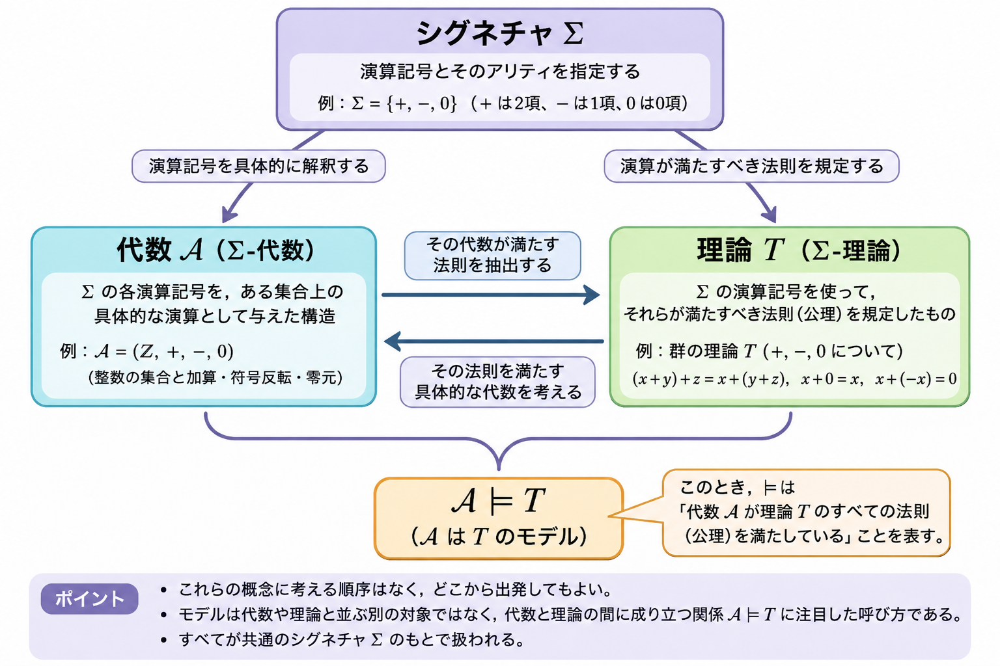

# 原論文による特徴づけ

代数的エフェクトとは何なのでしょうか。

提唱者たちによる主要論文にあたってみましょう。

主要論文はいくつかありますが、そのうちの Plotkin と Pretnar による2013年の論文 [Handling Algebraic Effects](https://homepages.inf.ed.ac.uk/gdp/publications/handling-algebraic-effects.pdf) の冒頭、Abstractには次のように書かれています。

> Algebraic effects are computational effects that can be represented by an equational theory whose operations produce the effects at hand. The free model of this theory induces the expected computational monad for the corresponding effect.

代数的エフェクトとは、対象としているエフェクトを生み出す operation をもつ等式理論によって表現できる計算エフェクトである。この理論の自由モデルは、対応するエフェクトに期待される計算モナドを誘導する。

このように特徴づけられるものとして説明されているわけですが、これを理解するには、少なくとも次の疑問に答える必要がありそうです。

1. 計算エフェクトとは何か。
2. 演算（operation）がエフェクトを生み出すとはどういうことか。
3. 等式理論によって表現できるとはどういうことか。
4. 自由モデルとは何か。また、それが計算モナドを誘導するとはどういうことか。

これらの疑問を、本書を通じて明らかにしていきたいと思います。

# 本章の流れ

本書の目的は、代数的エフェクトとハンドラーについて提唱者たちの主要論文を元に数学的な理解を得ることです。

したがって数学的な説明を行っていくわけですが、説明にあたりまずはこれらの主要論文の数学的な部分が主にどういった分野の語彙で書かれているかを伝えます。

順番に説明します。

まず、**普遍代数学（universal algebra）** という分野があります。

普遍代数学は、群や環などの代数的構造に共通する性質を抽出し、それらを統一的に扱う数学の分野です。

この普遍代数学における演算と等式によって記述される代数的構造は、圏論の言葉でも捉えることができます。

主要論文の数学に関する内容には、こうした圏論による捉え方が用いられています。

したがって本書も、このような圏論による捉え方を中心に進めていくわけですが、そこで使われる語彙には普遍代数学に由来するものがあるため、最低限必要な概念を予備知識として説明します。

その後に、圏論の言葉による説明を行います。

# 予備知識

まずは「演算」「代数」「理論」「モデル」という言葉の意味を整理しておきます。

これらは普遍代数学で用いられる基本的な概念です。

本書では古典的な普遍代数学そのものを体系的に学ぶわけではありません。

ここでは、後に登場する圏論的な定義を理解するために、基本的な考え方だけを確認します。

## 演算

数学における **演算（operation）** とは、与えられた対象から新しい対象を得る操作のことです。

例えば、自然数の加算

$$
+:\mathbb{N}\times\mathbb{N}\to\mathbb{N}
$$

は、二つの自然数を受け取って一つの自然数を返す演算です。

まず、入力の数が有限個である演算を考えます。

集合 $A$ 上の $n$ 項演算（$n$-ary operation）とは、写像

$$
f:A^n\to A
$$

のことです。

ここで $A^n$ は $A$ の $n$ 個の直積を表します。

この $n$ を演算のアリティ（arity）と呼びます。

加算や乗算は2項演算、符号反転は1項演算です。また、0項演算は $A^0$ が一元集合であることから、$A$ の元を一つ指定することに相当します。したがって、定数も演算の一種として扱います。

ここで重要なのは、**演算そのものと演算を表す記号を区別すること**です。

例えば、記号 $+$ だけでは、自然数の加算なのか、整数の加算なのか、別の構造上の演算なのかは決まりません。

同じ演算記号であっても、それをどの集合上でどのような写像として解釈するかによって、具体的な演算は異なります。

なお、本章では有限アリティの演算を扱いますが、代数的エフェクトの理論では無限集合をアリティとする演算も考えます。こちらは後の章で扱います。

## 代数

**代数（algebra）** という言葉は多義的で、文脈によって異なる意味で使われます。

代数学という研究分野を指すこともあれば、体上の代数のような特定の数学的構造を指すこともあります。

本書でまず注目するのは、「集合と、その集合上に定められた演算からなる構造」という意味です。

普遍代数学では、演算記号の集合を **シグネチャ（signature）** と呼び、$\Sigma$ と書きます。シグネチャの各演算記号には、そのアリティが指定されています。

**$\Sigma$ に対する代数（$\Sigma$-algebra）** とは、集合 $A$ と、各演算記号 $\sigma\in\Sigma$ に対応する具体的な演算

$$
\sigma^{\mathcal A}:A^{n_\sigma}\to A
$$

を備えた構造 $\mathcal A$ です。

これをまとめると、

$$
\mathcal A=
\left(A,(\sigma^{\mathcal A})_{\sigma\in\Sigma}\right)
$$

と表せます。

ここで $n_\sigma$ は演算記号 $\sigma$ のアリティです。また、集合 $A$ を代数 $\mathcal A$ の **台集合（underlying set）** と呼び、代数そのものと区別します。

### 【例】群

例えば、群を考えてみましょう。

群とは、集合と、その集合上に定められた演算からなる代数的構造の一つです。

群には、二項演算、各元の逆元を与える単項演算、単位元を表す定数があり、これらが一定の法則を満たします。

具体例として、整数の加法群があります。整数の集合 $\mathbb Z$ に対して、加算 $+$、符号反転 $-$、零元 $0$ を備えた構造です。

ここで、群を考えるために必要な演算を、演算記号とそのアリティによって表してみましょう。

群を考えるためのシグネチャとして、

$$
\Sigma=\{\cdot,(-)^{-1},e\}
$$

を取ります。
それぞれ、二項演算、逆元を取る単項演算、単位元を表す0項演算の記号であり、アリティは $2,1,0$ です。

このシグネチャに対する代数 $\mathcal A$ は、台集合 $A$ と、次の演算を備えた構造です。

$$
\begin{aligned}
\cdot &: A\times A\to A\\
(-)^{-1} &: A\to A\\
e &: A^0\to A
\end{aligned}
$$

したがって、

$$
\mathcal A=(A,\cdot,(-)^{-1},e)
$$

と表せます。

ここでは演算記号と具体的な演算に同じ表記を用いていますが、前者はシグネチャの要素、後者は代数におけるその解釈です。

ただし、これらの演算を備えているだけでは、まだ群とは限りません。

群であるためには、結合律や単位元の法則、逆元の法則も満たす必要があるからです。

つまり、**どのような演算を備えるか**と、**それらの演算がどのような法則を満たすか**は区別して考えることができます。

## 理論

**理論（theory）** とは、ここでは、どのような演算があり、それらがどのような法則を満たすべきかを規定するものを指します。

例えば、群では次のような法則を要求します。

$$
\begin{aligned}
(x\cdot y)\cdot z&=x\cdot(y\cdot z)\\
x\cdot e&=x=e\cdot x\\
x\cdot x^{-1}&=e=x^{-1}\cdot x
\end{aligned}
$$

ここで $x^{-1}$ は $\operatorname{inv}(x)$ を表します。

これらは特定の群の元についての等式ではなく、変数にどのような元を代入しても成立すべき法則です。

一方、アーベル群では、群と同じ演算を用いながら、さらに可換律

$$
x\cdot y=y\cdot x
$$

を要求します。

つまり、群とアーベル群は同じシグネチャを使うことができますが、要求される法則は異なります。

このように、**演算とそれらが満たすべき法則によって、どのような代数的構造を考えるのかを規定する**のが理論の役割です。

ここでは理論の役割を説明しましたが、理論を数学的にどのような対象として定義するかは、採用する定式化によって異なります。

本書では、こうした理論を圏論の言葉で定義します。

## モデル

ある理論が要求する法則を満たす具体的な代数を、その理論の **モデル（model）** と呼びます。

例えば、整数の加法群

$$
\mathcal Z=(\mathbb Z,+,-,0)
$$

は、群の理論のモデルです。

ここで $\mathbb Z$ は台集合、$\mathcal Z$ はその上に加算、符号反転、零元を備えた代数を表しています。

一方、整数の加法群は可換律も満たすため、アーベル群の理論のモデルでもあります。

つまり、**理論は代数的構造を規定し、モデルはその規定を満たす具体的な代数**です。

「代数」という言葉は集合と演算からなる構造に注目し、「モデル」という言葉は、その構造がある理論を満たしているという関係に注目しています。

## 予備知識のまとめ

ここまで説明した演算、代数、理論、モデルの関係を整理しておきましょう。

図のように、共通のシグネチャのもとで代数と理論を考えることができます。

代数は、演算記号を具体的な集合上の演算として解釈した構造です。
一方、理論は、それらの演算が満たすべき法則を規定します。

代数 $\mathcal A$ が理論 $T$ のすべての法則を満たすとき、$\mathcal A$ を $T$ のモデルと呼びます。

ここで重要なのは、**これらの概念には、考える順序が決まっているわけではない**ということです。

例えば、整数の集合 $\mathbb Z$ と、加算 $+$、符号反転 $-$、零元 $0$ を備えた代数から出発することができます。

この代数が満たす法則を調べると、結合律や単位元の法則、逆元の法則に加えて、可換律も満たすことがわかります。
したがって、この代数は群の理論だけでなく、アーベル群の理論のモデルでもあります。

逆に、群の理論から出発することもできます。群の理論が要求する法則を満たす具体的な代数を考えれば、整数の加法群などがそのモデルとして得られます。

また、すでに群の理論のモデルとして与えられた整数の加法群を調べ、可換律も満たすことから、アーベル群の理論のモデルでもあるとわかる場合もあります。

このように、具体的な代数から法則を考えることも、理論からそのモデルを考えることも、既知のモデルから別の理論との関係を考えることもできます。

代数、理論、モデルは、順番に作られるものではありません。
モデルとは、ある代数がある理論を満たすという関係に注目した呼び方なのです。

# 代数理論

ここまで、普遍代数学における演算、代数、理論、モデルの基本的な意味を見てきました。

ここで扱うような、演算とその法則によって代数的構造を規定する理論を、代数理論と呼びます。

それでは、これらの概念を圏論の言葉ではどのように表現できるでしょうか。

代数理論の圏論的な定式化では、演算や変数の代入といった構造を、圏の射とその合成によって捉えます。

そして、代数理論を一定の条件を満たす圏として定式化し、そのモデルを有限積保存関手として表します。

第2章では、こうして定義された代数理論を、演算記号と等式によって提示する方法を説明します。

以下では、まず対象の種類を一つに限り、有限アリティの演算を扱う **単ソート代数理論** を定義します。

<!--
執筆用メモ（公開前に削除）

到達目標
群などの具体例を通して演算・理論・モデルという語の役割をつかみ、それらを有限積に基づく単ソート代数理論とSet値有限積保存関手として定式化できる。

想定読者
圏論の基礎とモナドを理解している読者。必要な圏論の基礎事項は前提とし、古典的普遍代数学については橋渡しとなる概念のみ説明する。

扱う内容と節構成
1. 概念的導入：演算・代数・理論・モデル。古典的普遍代数学の形式的な定義には立ち入らず、圏論的定義への橋渡しに限定する。
2. FinSet^opの骨格と標準関手 J : FinSet^op → L。
3. 単ソート代数理論（通常 *Lawvere theory* と呼ばれる対象）の定義と理論射。
4. 有限積と有限アリティ演算の対応、および射の合成としての代入。
5. Set値有限積保存関手としてのモデルと、モデル間の自然変換。
6. 群などの具体的な代数系との対応。

証明範囲
A（本編で証明する）：
標準的な小例について、有限積・演算・代入の具体的対応を検証する。

B（定理と証明の要点を説明する）：
一般の有限積圏に関する周辺結果。

C（原典を参照する）：
多ソート理論への一般化と、本編で詳細を扱わない周辺結果。

他章への依存関係
本章は第2章の自由理論・商理論・モデル対応、および第4章の有限生成自由モデルとの対応に用いる。
第IV部の核心的証明は、第3章・第4章から第11〜13章へ進む経路を取り、第III部を前提にしない。

数学的な注意事項と保留事項
有限積による単ソート代数理論は有限アリティを表す。一般集合アリティまで同じ枠組みだけで扱えるとは説明しない。
用語は「単ソート代数理論」「等式による提示」に統一する。
古典的普遍代数学の導入は概念的な橋渡しに限定する。
第2章では代数理論の等式による提示を扱う。
集合アリティの一般化は第3章で扱う。

記法の統一
A：台集合
mathcal A：代数
sigma^{mathcal A}：代数mathcal Aにおける演算記号sigmaの解釈
Sigma：シグネチャ

参照すべき原典
Burris–Sankappanavar, A Course in Universal Algebra, Chapter II §1。
Adámek–Rosický–Vitale, Algebraic Theories: A Categorical Introduction to General Algebra, 11.3–11.4。
-->
