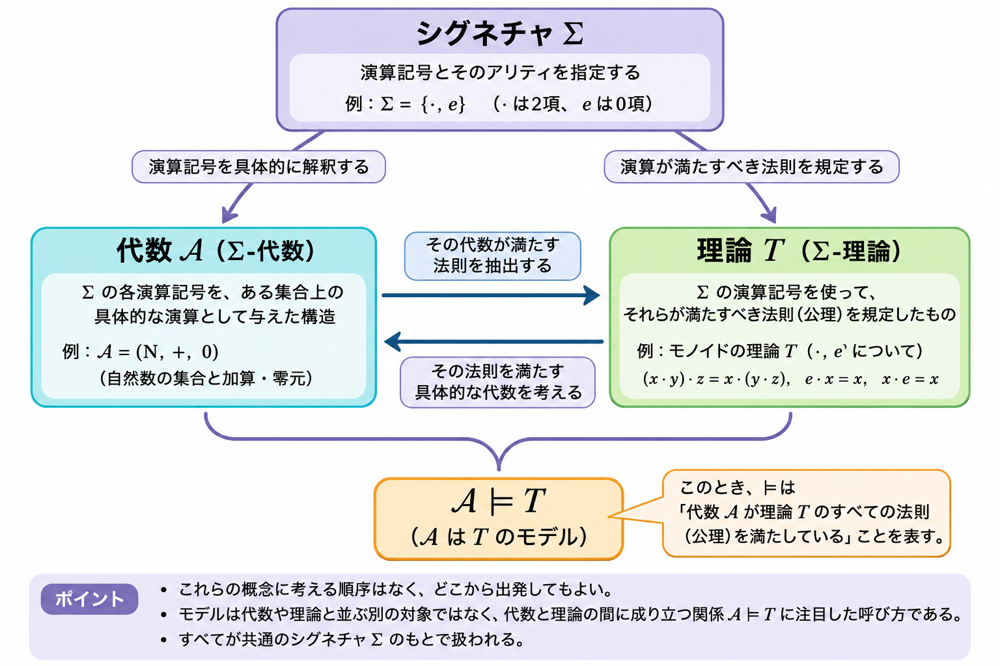

# 本章の流れ

本書では、代数的エフェクトとハンドラーの数学的な理論を説明していきます。

その中では、代数理論、演算、等式、モデル、自由モデルといった概念が登場します。

これらの言葉は、普遍代数学や数理論理学といった分野でも使われており、もともとは馴染みのある数学的な考え方と結び付いています。

一方、代数的エフェクトの数学的な背景にある圏論的普遍代数学では、これらの概念を圏論の言葉で定式化できます。例えば、本書で採用する定式化では、代数理論を有限積を持つ小圏として定義し、そのモデルを有限積保存関手として定義します。

初見だと、「理論が圏？」「関手がモデル？」と感じられるかもしれません。

私自身は最初「理論」や「モデル」という言葉から想像するものと結びつかず、「まぁこういうものと飲み込むか」と割り切って学習を進めていました。

しかし、これらは無関係な概念に同じ名前を付けたものではありません。

演算とそれらが満たす法則を考え、その法則を満たす具体的な構造を考えるという基本的な発想が、圏論の言葉によって捉え直されているのです。

本章では、まずモデル理論における理論とモデルの基本的な考え方を確認します。次に普遍代数学へ進み、演算と等式によって代数的構造を記述する方法を説明します。

最後に、これらの概念が圏論ではどのように表現されるのかを説明し、三つの分野の関係を整理します。

:::message
本書の主軸は、代数理論とそのモデルの圏論的な定式化です。モデル理論は背景として確認し、普遍代数学は圏論との対応を理解するために必要な概念に絞って扱います。各分野の理論全体を展開することは目的としません。

本書では、複数の文献を参照しながら理論を展開します。そのため、本書全体での記法の一貫性を保つために、参照先の文献とは異なる記号を用いる場合があります。

代数的エフェクトの原論文では、例えば Plotkin–Power（2002）や Plotkin–Pretnar（2013）は、演算記号と等式による提示を用いて理論を扱っています。Lawvere 理論との関係も論じられていますが、本章で採用する一般の有限積圏としての定義をそのまま原論文の定義として用いているわけではありません。
:::

# モデル理論における理論とモデル

最初に、「理論」と「モデル」という言葉について考えてみましょう。

数学では、何らかの法則や公理を定め、それらが成り立つ対象を研究することがあります。例えば、ある演算が結合律や単位元の法則を満たすことを要求し、そのような演算を持つ数学的な構造について調べることができます。

このような、数学的な法則と、それを満たす構造との関係を研究する分野の一つが、**モデル理論（model theory）** です。モデル理論は、数理論理学の一分野です。

ここでは、等号付きの一階述語論理を扱います。

## 言語

モデル理論では、まず数学的な主張を記述するための **言語（language）** を定めます。

**【定義】一階言語**

述語記号（例えば $<$ や $\in$）の集合を $R$、関数記号（例えば $+$ や $\times$）の集合を $F$、定数記号（例えば $0$、$1$、$e$）の集合を $C$ とする。これらは互いに素な集合であり、各述語記号と関数記号には $1$ 以上の整数で表される **アリティ（arity）** が指定されているものとする。例えば、$<$ や $\in$ は $2$ 項述語記号、$+$ や $\times$ は $2$ 項関数記号として使用できる。

このとき、

$$
L=R\cup F\cup C
$$

を **一階言語（first-order language）** と呼ぶ。

定数記号は0項関数記号とみなすこともできますが、ここでは関数記号と区別します。また、0項述語記号は扱いません。この約束は Tent–Ziegler の定義に従っています。

この定義で指定しているのは、言語に固有の記号です。等号、論理結合子、量化子、変数などは、これとは別に共通の論理記号として用います。

例えば、二項演算を表す記号 $\cdot$ と、定数を表す記号 $e$ のみを持つ言語では、

$$
R=\varnothing,\qquad F=\{\cdot\},\qquad C=\{e\}
$$

であり、$\cdot$ のアリティは $2$ です。この段階では、記号 $\cdot$ がどの集合上のどの演算を表すかは決まっていません。

## 構造

言語に登場する記号は、それだけでは具体的な意味を持ちません。例えば、二項演算記号 $\cdot$ が、どの集合上のどの演算を表すかは、言語を定めただけでは決まりません。

そこで、記号に具体的な意味を与えた数学的な構造を考えます。

**【定義】言語の構造**

一階言語 $L=R\cup F\cup C$ に対する **$L$-構造（$L$-structure）** $\mathfrak A$ とは、次のデータからなる。

1. 空でない集合 $A$。
2. 各定数記号 $c\in C$ に対する元 $c^{\mathfrak A}\in A$。
3. 各 $n$ 項関数記号 $f\in F$ に対する写像 $f^{\mathfrak A}:A^n\to A$。
4. 各 $n$ 項述語記号 $r\in R$ に対する部分集合 $r^{\mathfrak A}\subseteq A^n$。

$A$ を $\mathfrak A$ の **台集合（underlying set）** と呼ぶ。

つまり、関数記号は具体的な関数、述語記号は具体的な関係、定数記号は台集合の元として解釈されます。

例えば、自然数の集合 $\mathbb N$ を台集合として、$\cdot$ を加算 $+$、$e$ を $0$ として解釈すれば、

$$
\mathfrak N=(\mathbb N,+,0)
$$

という構造が得られます。

## 理論とモデル

言語からは、変数や関数記号を組み合わせた **項（term）**、等号や述語記号、論理記号、量化子などを用いた **論理式（formula）** を作れます。論理式のうち、自由変数を持たないものを **文（sentence）** と呼びます。

さらに、言語の記号を解釈した構造の中で、その文が真になるかどうかを定められます。これを文の **充足（satisfaction）** といいます。充足関係を $\mathfrak A\models\varphi$ と書きます。

**【定義】理論とモデル**

一階言語 $L$ の文全体の集合を $\operatorname{Sent}(L)$ と書く。

$$
T\subseteq\operatorname{Sent}(L)
$$

を $L$ の **理論（theory）** と呼ぶ。$L$-構造 $\mathfrak A$ が $T$ のすべての文を満たすとき、$\mathfrak A$ を $T$ の **モデル（model）** と呼ぶ。すなわち、

$$
\mathfrak A\models T
\iff
\text{すべての }\varphi\in T\text{ について }\mathfrak A\models\varphi.
$$

理論を単に文の集合と呼ぶ場合と、そこから論理的に導かれる帰結をすべて含む集合として扱う場合があります。後者は **演繹的に閉じた理論** です。本書では、必要に応じて、公理として選んだ文とその帰結を区別します。この二つの用法については、Doets, *Basic Model Theory*, §3.40 を参照してください。

ここでは、項や論理式を作る規則、および充足関係の帰納的な定義は展開しません。これらは一階論理の構文と意味論の基礎ですが、本章では、**理論が要求する性質と、それを満たす構造が区別される**ことを押さえれば十分です。

:::message
一階言語・構造・項・論理式・充足関係の詳しい定義は、Katrin Tent・Martin Ziegler, *A Course in Model Theory* の第1章 §§1.1–1.2を参照してください。[Cambridge University Press公式の無料試読PDF](https://assets.cambridge.org/97805217/63240/excerpt/9780521763240_excerpt.pdf)では、同章の冒頭部分を読むことができます。第1章の全体が無料公開されているという意味ではありません。
:::

## 【例】モノイド

理論とモデルの関係を、モノイドという代数的構造を使って考えてみましょう。

モノイドとは、集合と、その集合上の二項演算および単位元を備えた構造で、結合律と単位元の法則を満たすものです。

先ほどの関数記号 $\cdot$ と定数記号 $e$ を持つ言語で、結合律と単位元の法則を次の文として記述します。

結合律：

$$
\forall x\,\forall y\,\forall z\;
((x\cdot y)\cdot z=x\cdot(y\cdot z))
$$

単位元の法則：

$$
\forall x\;(e\cdot x=x\land x\cdot e=x)
$$

この二つの文からなる集合を、モノイドの理論 $T_{\mathrm{Mon}}$ とします。

では、そのモデルとは何でしょうか。

例えば、$\cdot$ を自然数の加算 $+$、$e$ を $0$ として解釈した構造

$$
\mathfrak N=(\mathbb N,+,0)
$$

を考えます。自然数の加算は結合律を満たし、$0$ は加算の単位元です。したがって、

$$
\mathfrak N\models T_{\mathrm{Mon}}
$$

が成り立ちます。

つまり、理論では演算の具体的な意味を決めずに法則を記述し、モデルでは演算に具体的な意味を与え、その法則が成り立つことを確認するわけです。

## ここまでのまとめ

モデル理論では、数学的な性質を記述するための言語を定め、その言語で書かれた文の集合を理論として扱います。

一方、言語に登場する記号に具体的な解釈を与えたものが構造です。その構造において、理論に属するすべての文が成り立つとき、その構造を理論のモデルと呼びます。

モノイドの例を使って、これらの関係を図にまとめると次のようになります。なお、図では演算記号を $\cdot,e$ ではなく $+,0$ と表記しています。


ここで重要なのは、**理論が要求する性質と、それを満たす具体的な構造を区別している**ということです。

また、理論と構造のどちらから考え始めても構いません。理論が先にあって、それを満たす構造を探すことも、具体的な構造から出発して、そこで成り立つ性質を調べることもできます。

モデル理論では、こうした関係を基礎として、どのようなモデルが存在するのか、異なるモデルにはどのような性質が共通するのか、といった問題も研究します。

次に、普遍代数学を見ていきます。普遍代数学では、特に演算とそれらが満たす等式に注目し、代数的構造に共通する性質を研究します。

# 普遍代数学における理論とモデル

普遍代数学（universal algebra）は、モノイド、群、環などの代数的構造に共通する性質を抽出し、それらを統一的に扱う数学の分野です。

モデル理論では、演算に限らず、対象の間の関係や、さまざまな数学的性質を記述できます。

一方、古典的な普遍代数学では、主に **演算と、それらの演算が満たす等式** に注目します。等式は一階論理の文（変数を全称量化したもの）として表せるので、普遍代数学の等式理論は、一階論理で扱う理論と直接結び付いています。

:::message
普遍代数学の定義と定理を詳しく学ぶには、Stanley Burris・H. P. Sankappanavar, *A Course in Universal Algebra* を参照してください。本章に関係するのは第II章の §1（演算と代数）、§10（項）、§11（等式）、§14（等式理論と代入）です。[著者の大学公式サイトで公開されている2012年版PDF](https://www.math.uwaterloo.ca/~snburris/htdocs/UALG/univ-algebra2012.pdf)を無料で読むことができます。
:::

## 演算とシグネチャ

**【定義】$n$ 項演算**

空でない集合 $A$ 上の **$n$ 項演算（$n$-ary operation）** とは、写像

$$
f:A^n\to A
$$

のことです。ここで $A^n$ は $A$ の $n$ 個の直積を表します。

加算や乗算は2項演算、符号反転は1項演算です。また、0項演算は $A^0$ が一元集合であることから、$A$ の元を一つ指定することに相当します。したがって、定数も演算の一種として扱います。

ここで重要なのは、**演算そのものと演算を表す記号を区別すること**です。

**【定義】シグネチャ**

以下、$\mathbb N=\{0,1,2,\ldots\}$ とします。

集合 $\Sigma$ と写像

$$
\operatorname{ar}:\Sigma\to\mathbb N
$$

の組 $(\Sigma,\operatorname{ar})$ を、**シグネチャ（signature）** と呼ぶ。文脈上明らかなときは単に $\Sigma$ と書く。$\Sigma$ の元 $\sigma$ を演算記号、$\operatorname{ar}(\sigma)$ をそのアリティと呼ぶ。

例えば、記号 $+$ だけでは、自然数の加算なのか、整数の加算なのか、別の構造上の演算なのかは決まりません。

シグネチャは、どのような演算を使用するかを指定しますが、それぞれの演算の具体的な意味や、それらが満たすべき法則までは指定しません。

## 代数

**代数（algebra）** という言葉は多義的で、文脈によって異なる意味で使われます。代数学という研究分野を指すこともあれば、体上の代数のような特定の数学的構造を指すこともあります。

本書でまず注目するのは、「集合と、その集合上に定められた演算からなる構造」という意味です。

**【定義】$\Sigma$-代数**

シグネチャ $(\Sigma,\operatorname{ar})$ に対する **$\Sigma$-代数（$\Sigma$-algebra）** $\mathbf A$ とは、空でない集合 $A$ と、各 $\sigma\in\Sigma$ に対する写像

$$
\sigma^{\mathbf A}:A^{\operatorname{ar}(\sigma)}\to A
$$

からなる組

$$
\mathbf A=\left(A,(\sigma^{\mathbf A})_{\sigma\in\Sigma}\right)
$$

である。$A$ を $\mathbf A$ の **台集合（underlying set）** と呼ぶ。

ここでは Burris–Sankappanavar に従い、台集合を空でない集合とします。これは本章で採用する約束です。後の圏論的な代数理論では空集合を台集合とするモデルも現れるため、両者の対応を述べる際には違いを明示します。

$\Sigma$-代数を定義する段階では、演算に特別な法則を要求していません。例えば、二項演算と定数を備えた代数であっても、その二項演算が結合律を満たすとは限りません。

## 項と等式理論

普遍代数学では、演算記号から作られる項の間の等式によって、代数的構造が満たすべき法則を記述します。

**【定義】$\Sigma$-項**

変数の集合 $X$ とシグネチャ $\Sigma$ に対し、**$\Sigma$-項** の集合 $\operatorname{Term}_{\Sigma}(X)$ を、次の条件を満たす最小の集合として定める。

1. すべての $x\in X$ は項である。
2. $\sigma\in\Sigma$ のアリティが $n$ で、$t_1,\ldots,t_n$ が項なら、$\sigma(t_1,\ldots,t_n)$ も項である。

例えば、二項演算記号 $\cdot$ と定数記号 $e$ があれば、

$$
x\cdot y,\qquad (x\cdot y)\cdot z,\qquad x\cdot e
$$

などの項を作ることができます。

ここからは、項に別の項を代入する操作と、項を具体的な代数で評価する方法を定めます。前者は後の圏論的な説明のために本書で明示する定式化であり、後者は Burris–Sankappanavar の Definition 10.2 に対応します。

以下、$n\in\mathbb N$ に対し $X_n=\{x_0,\ldots,x_{n-1}\}$ と書きます。特に $X_0=\varnothing$ です。

**【定義】項の代入**

変数集合 $X_n$ 上の項 $t\in\operatorname{Term}_{\Sigma}(X_n)$ と、変数集合 $X_m$ 上の項 $s_0,\ldots,s_{n-1}\in\operatorname{Term}_{\Sigma}(X_m)$ に対し、代入後の項

$$
t[s_0/x_0,\ldots,s_{n-1}/x_{n-1}]\in\operatorname{Term}_{\Sigma}(X_m)
$$

を、$t$ の構成に関する帰納法で定める。$t=x_i$ のとき結果は $s_i$ とし、$t=\sigma(t_1,\ldots,t_k)$ のときは、

$$
\sigma\bigl(t_1[s_0/x_0,\ldots,s_{n-1}/x_{n-1}],\ldots,t_k[s_0/x_0,\ldots,s_{n-1}/x_{n-1}]\bigr)
$$

とする。$k=0$ の場合、定数記号はそのまま残る。

例えば、$t=x_0\cdot x_1$ に、$s_0=x_0\cdot e$ と $s_1=x_1$ を代入すれば、$(x_0\cdot e)\cdot x_1$ を得ます。この項の代入が、後で説明する圏の射の合成につながります。

**【定義】項の解釈**

$\Sigma$-代数 $\mathbf A$ と、$X_n$ 上の項 $t$ に対し、写像

$$
t^{\mathbf A}:A^n\to A
$$

を次のように帰納的に定義する。変数 $x_i$ については、$i$ 番目の射影（添字は $0$ から始める）を用いて

$$
x_i^{\mathbf A}=\pi_i:A^n\to A
$$

とし、$k$ 項演算記号 $\sigma$ と項 $t_1,\ldots,t_k$ に対しては

$$
(\sigma(t_1,\ldots,t_k))^{\mathbf A}
=\sigma^{\mathbf A}\circ\langle t_1^{\mathbf A},\ldots,t_k^{\mathbf A}\rangle
$$

とする。$k=0$ の場合、右辺は $A^n$ 上の定数写像である。

この定義から、項を評価する操作そのものが、射影・演算・写像の合成によって組み立てられていることが分かります。

**【定義】等式とその充足**

同じ変数集合 $X_n$ 上の二つの項 $s,t\in\operatorname{Term}_{\Sigma}(X_n)$ と、その変数の文脈 $X_n$ の組を **等式（equation）** と呼び、$s=t$ と書く。すべての $n\in\mathbb N$ に関する等式全体の集合を $\operatorname{Eq}_{\Sigma}$ と書く。

$\Sigma$-代数 $\mathbf A$ が等式 $s=t$ を **満たす** とは、

$$
s^{\mathbf A}=t^{\mathbf A}:A^n\to A
$$

が成り立つことをいう。等式の集合 $E$ のすべての等式を満たす場合、$\mathbf A\models E$ と書く。

等式を満たすとは、変数にどのような値を代入しても両辺が等しくなる、ということです。モデル理論で見た全称量化子 $\forall$ は、通常、この記法では省略されます。

**【定義】等式による提示と等式理論**

シグネチャ $\Sigma$ と、そのシグネチャに関する等式の集合 $E\subseteq\operatorname{Eq}_{\Sigma}$ の組

$$
(\Sigma,E)
$$

を **等式による提示（equational presentation）** と呼ぶ。この提示が規定する **等式理論** は、$E$ のすべてのモデルで成立する等式全体、すなわち

$$
\operatorname{Th}_{\Sigma}(E)
=
\{s=t\in\operatorname{Eq}_{\Sigma}\mid
\text{すべての }\mathbf A\models E\text{ に対して }\mathbf A\models(s=t)\}
$$

とする。ここで、右辺の等式にはその変数の文脈も含めるものとする。

このように提示と理論そのものを区別しておくのは、同じ等式理論を異なる公理の集合で指定できるからです。異なる公理の集合であっても、それらから同じ等式が帰結する場合があります。

なお、文献によっては $(\Sigma,E)$ 自体を **等式理論（equational theory）** と呼びます。本書では、必要に応じて提示とそこから帰結する等式全体を区別します。

## モデル

**【定義】等式理論のモデル**

等式による提示 $(\Sigma,E)$ に対して、$E$ のすべての等式を満たす $\Sigma$-代数 $\mathbf A$ を、その提示が定める理論の **モデル（model）** と呼ぶ。

つまり、

$$
\mathbf A\models E
\iff
\forall(s=t)\in E,\quad
s^{\mathbf A}
=
t^{\mathbf A}.
$$

ここでは、シグネチャに対する代数と、等式を満たすモデルを区別しています。この点では、モデル理論で見た理論とモデルの関係と同じ考え方です。

普遍代数学では、モデルとなる代数的構造を、演算と等式に注目して研究します。例えば、異なる代数の間で演算を保つ写像を考えたり、演算と等式だけから新たな代数を構成したりします。

こうした構成は後の章で扱います。

## 【例】モノイド

ここまでの概念を、改めてモノイドに当てはめてみましょう。

モノイドでは、二項演算と単位元を使います。したがって、

$$
\Sigma=\{\cdot,e\},\qquad
\operatorname{ar}(\cdot)=2,\quad
\operatorname{ar}(e)=0
$$

というシグネチャを取ることができます。

このシグネチャに対する代数 $\mathbf A$ は、台集合 $A$ と、次の演算を備えた構造です。

$$
\begin{aligned}
\cdot^{\mathbf A}&:A\times A\to A\\
e^{\mathbf A}&:A^0\to A
\end{aligned}
$$

具体的な演算の表記を簡略化すれば、$\mathbf A=(A,\cdot,e)$ と表せます。ただし、これらの演算を備えているだけでは、まだモノイドとは限りません。

モノイドであるためには、結合律と単位元の法則

$$
\begin{aligned}
(x\cdot y)\cdot z&=x\cdot(y\cdot z)\\
x\cdot e&=x=e\cdot x
\end{aligned}
$$

を満たす必要があるからです。

これらの等式の集合を $E_{\mathrm{Mon}}$ とすると、$(\Sigma,E_{\mathrm{Mon}})$ はモノイドの理論を提示します。

例えば、自然数の加法モノイド

$$
\mathbf N=(\mathbb N,+,0)
$$

は、この等式をすべて満たすので、モノイドの理論のモデルです。

また、同じ理論には、文字列の集合を台集合とし、文字列の連結と空文字列を演算として備えたモデルも存在します。

つまり、同じ演算記号と等式からなる理論に対して、異なる具体的な演算を与えたモデルが存在するわけです。

## ここまでのまとめ

ここまで説明した演算、代数、理論、モデルの関係を整理しておきましょう。



図のように、共通のシグネチャのもとで代数と理論を考えることができます。

代数は、演算記号を具体的な集合上の演算として解釈した構造です。一方、理論は、それらの演算が満たすべき法則を規定します。代数 $\mathbf A$ が理論のすべての法則を満たすとき、$\mathbf A$ をそのモデルと呼びます。

ここで重要なのは、**これらの概念には、考える順序が決まっているわけではない**ということです。

例えば、自然数の加法モノイドという具体的な代数から出発して、その満たす法則を調べることができます。逆に、モノイドの理論から出発し、その法則を満たす具体的な代数を考えることもできます。

代数、理論、モデルは、必ずしも順番に作られるものではありません。モデルとは、ある代数がある理論を満たすという関係に注目した呼び方なのです。

# 代数理論の圏論的な定式化

ここまで、モデル理論と普遍代数学における理論とモデルの考え方を見てきました。

それでは、演算と等式によって規定される代数的構造を、圏論の言葉ではどのように表現できるでしょうか。

ここで重要なのは、**演算・代入・等式の構造を、圏の射・合成・射の等しさとして捉える**という考え方です。

この考え方は、Lawvere による1963年の *Functorial Semantics of Algebraic Theories* にさかのぼります。Lawvere は、一つの対象とその有限回の積を用いて、演算と等式を圏として表現する方法を示しました。

その後、この考え方は一般化されました。本章では、特定の対象をあらかじめ選ばない、有限積を持つ小圏としての一般の代数理論を扱います。

## 代数理論

**【定義】代数理論**

**代数理論（algebraic theory）** とは、有限積を持つ小圏 $\mathcal T$ のことである。

この定義には、特定の演算記号や等式の集合は直接登場しません。では、なぜ有限積を持つ小圏を「理論」と呼ぶのでしょうか。射と演算の関係から考えてみましょう。

ある集合 $A$ 上の $n$ 項演算は、写像

$$
f:A^n\to A
$$

でした。ここで、入力が一種類の集合に限られない場合も考えてみましょう。集合 $A_1,\ldots,A_n,B$ に対して、

$$
f:A_1\times\cdots\times A_n\to B
$$

という写像を考えることができます。

有限積を持つ圏 $\mathcal T$ でも、対象 $X_1,\ldots,X_n,Y$ に対し、射

$$
f:X_1\times\cdots\times X_n\to Y
$$

を考えられます。


*圏のイメージ*

これを、複数の入力から一つの出力を得る演算として読むことができます。

プログラム的に書くならば、$n$ 個の要素からなるタプルを入力とする関数のように考えられます。以下は型シグネチャ風の表記です。

```hs
f :: (X1, ..., Xn) -> Y
```

また、射 $f:X\to Y$ と $g:Y\to Z$ の合成

$$
g\circ f:X\to Z
$$

は、ある演算の結果を別の演算に渡すことに対応します。

さらに、同じ対象 $X$ から出る二つの射 $f:X\to Y$ と $g:X\to Z$ は、有限積の普遍性によって、

$$
\langle f,g\rangle:X\to Y\times Z
$$

という一つの射にまとめられます。これは、同じ入力から複数の結果を得る演算の組として捉えることができます。
:::message
【補足】
同じ対象 $X$ から出る二つの射 $f:X\to Y$ と $g:X \to Z$ に対して、
$$\langle f,g\rangle:X\to Y\times Z$$ という射が一意に存在します。この射は、積の射影 $\pi_Y,\pi_Z$ に対して

$$
\begin{array}{rcl}
\pi_Y\circ\langle f,g\rangle & = & f \\
\pi_Z\circ\langle f,g\rangle & = & g
\end{array}
$$

を満たします。これが積の普遍性です。

*積の普遍性*
:::


さらに、射 $h:Y\times Z\to W$ があれば、これらを合成して

$$
h\circ\langle f,g\rangle:X\to W
$$

を構成できます。複数の演算の結果を、別の演算の引数として渡しているわけです。


プログラムでは、同じ引数を二つの関数に渡し、それぞれの戻り値をタプルにまとめて、別の関数に渡す操作に対応します。

```haskell
f :: X -> Y
g :: X -> Z
h :: (Y, Z) -> W

pair :: X -> (Y, Z)
pair x = (f x, g x)

combined :: X -> W
combined = h . pair
```

また、有限積に付随する射影、対角射 $\Delta_X=\langle\operatorname{id}_X,\operatorname{id}_X\rangle:X\to X\times X$、終対象への唯一の射 $!_X:X\to1$ は、それぞれ入力の選択・複製・破棄を表すこともできます。ここでは終対象を $1$ と書きます。


プログラムでは次のように表せます。

```haskell
-- 射影
projectY :: (y, z) -> y
projectY (y, _) = y

projectZ :: (y, z) -> z
projectZ (_, z) = z

-- 複製
duplicate :: x -> (x, x)
duplicate x = (x, x)

-- 破棄
discard :: x -> ()
discard _ = ()
```

このように、有限積を持つ圏では、必要な入力を取り出したり、同じ入力を複数回使ったり、複数の演算の結果を組み合わせて別の演算に渡したりできます。これは、普遍代数学で演算記号から項を作り、項の変数に別の項を代入することに対応します。

例えば、モノイドの理論では、二項演算記号 $\cdot$ と定数記号 $e$ から項を作りました。この演算と等式から生成した圏では、ある対象 $X$ の有限回の積を用いて、変数集合 $X_n$ 上の項を、理論の等式で同一視したうえで射

$$
X^n\to X
$$

として表せます。また、同じ変数集合 $X_n$ 上の $m$ 個の項の組は、射

$$
X^n\to X^m
$$

として表せます。ここで $X^n$ は $X$ の $n$ 個の積です。

項への代入は射の合成に、理論から帰結する等式は射の等しさに対応します。例えば、モノイドでは $x\cdot e=x$ なので、これらの項は同じ射を表します。具体的な圏の構成は次章で扱います。

こうして、**項・代入・等式を、射・合成・射の等しさとして表現できる**ことが、有限積を持つ圏を代数理論として扱う理由です。

ただし、**一般の有限積圏には、基本演算を表す射や、一つの基本となる対象があらかじめ指定されているわけではありません。** 特定の演算記号と等式から理論を提示する場合には対応する射を選べますが、代数理論の定義自体は、その選択に依存しません。

## モデルと代数

では、圏論的に定義された代数理論のモデルは何でしょうか。

普遍代数学では、モデルとは、理論に登場する演算を具体的な集合上の演算として解釈し、要求される等式を満たす構造でした。

圏論では、理論 $\mathcal T$ の対象と射を、集合とその間の写像として解釈します。これを関手によって表現します。

**【定義】代数理論の代数・モデル**

代数理論 $\mathcal T$ の **代数（$\mathcal T$-algebra）** とは、有限積を保存する関手

$$
A:\mathcal T\to\mathbf{Set}
$$

のことである。本書では、これを $\mathcal T$ の **モデル（model）** とも呼ぶ。

:::message
代数理論と代数の定義は Adámek–Rosický–Vitale, *Algebraic Theories: A Categorical Introduction to General Algebra* の Definition 1.1 に従っています。同書ではこの関手を algebra と呼んでいます。
:::

ここで「有限積を保存する」とは、終対象が終対象に写され、$\mathcal T$ の任意の有限個の対象の積に対して、像とそれぞれの対象の像の積との間の標準的な比較写像が同型になることをいう。特に、

$$
A(X\times Y)\cong A(X)\times A(Y)
$$

です。ただし、単に両辺の集合がたまたま同型であればよいのではなく、射影による標準的な比較写像が同型であることが必要です。

*代数理論 $\mathcal{T}$ とその代数のイメージ($n=2$の例)*

この定義では、普遍代数学の場合と異なり、代数とモデルを別々の数学的対象として定義していません。**$\mathcal T$-代数と $\mathcal T$ のモデルは、同じ有限積保存関手を指します。**

なぜ、この関手がモデルなのでしょうか。

関手 $A$ は、$\mathcal T$ の対象 $X$ を集合 $A(X)$ に対応させ、射 $f:X\to Y$ を写像

$$
A(f):A(X)\to A(Y)
$$

に対応させます。有限積を保存するため、理論における複数の入力を、集合の直積として解釈できます。

例えば、理論に二項演算を表す射 $\mu:X\times X\to X$ があるとします。$A(\mu)$ は $A(X\times X)\to A(X)$ という写像になります。有限積を保存しなければ、$A(X\times X)$ を標準的に $A(X)\times A(X)$ と同一視できるとは限らず、$A(\mu)$ を $A(X)$ 上の二項演算として解釈できる保証がありません。

さらに、関手は射の合成を保存します。

$$
A(g\circ f)=A(g)\circ A(f)
$$

つまり、理論における演算の組み合わせは、具体的な写像の合成として解釈されます。

また、$\mathcal T$ において二つの射 $f,g:X\to Y$ が等しければ、

$$
A(f)=A(g)
$$

が成り立ちます。したがって、理論に組み込まれた射の等しさは、具体的な解釈のもとでも保たれます。

モデルを有限積保存関手として定義することは、**理論の演算と法則を、具体的な集合と写像として解釈するという、これまでのモデルの考え方を圏論で表したもの**なのです。

### 代数とモデルが同じになる理由

ここで、普遍代数学の場合との違いを整理しておきましょう。

普遍代数学では、シグネチャ $\Sigma$ に対する代数を、等式を満たすかどうかとは独立に定義しました。その上で、等式の集合 $E$ を指定し、それを満たす $\Sigma$-代数をモデルと呼びました。

一方、圏論的な代数理論では、演算の間に成り立つ等式が、理論 $\mathcal T$ における射の等しさとしてすでに組み込まれています。そのため、有限積保存関手として理論を解釈すれば、その時点で理論の法則が満たされます。

ただし、これは普遍代数学における代数とモデルの区別が、数学的に意味を失ったということではありません。演算記号のみを指定した理論や、さらに等式を課した理論も、有限積圏によって表現できます。つまり、圏論では、シグネチャだけから自由に生成した理論のモデルなのか、そこに等式を課した理論のモデルなのか、という違いとして捉えられます。

なお、本章で採用した古典的な普遍代数学の代数は非空の台集合を要求するのに対し、圏論的なモデルは必ずしもそうではありません。例えば、演算記号も等式もない単ソートの理論の場合、前者は非空集合のみを扱い、後者では空集合もモデルとなります。そのため、二つの定式化が無条件に同じモデルの圏を与えるとは述べられません。正確な対応と必要な約束は、演算記号と等式による提示から圏を構成する章で説明します。

### モデル間の準同型

普遍代数学では、代数の演算を保つ写像を **準同型（homomorphism）** と呼びます。

**【定義】$\mathcal T$-代数の準同型と代数の圏**

二つの $\mathcal T$-代数 $A,B:\mathcal T\to\mathbf{Set}$ に対し、自然変換

$$
\alpha:A\Rightarrow B
$$

を、$\mathcal T$-代数の **準同型** と呼ぶ。$\mathcal T$-代数を対象、準同型を射とする圏を $\operatorname{Alg}\mathcal T$ と書く。

自然性は、任意の $f:X\to Y$ に対する等式

$$
B(f)\circ\alpha_X=\alpha_Y\circ A(f)
$$

です。これは、理論の射を具体的な集合上で解釈したとき、その演算を準同型が保つことに対応します。

## 【例】モノイド

ここまで定義した概念を、モノイドの理論に当てはめてみましょう。

モノイドでは、二項演算と単位元を考えました。これらを圏論的に表現するために、対象 $X$ と、二つの射

$$
\begin{aligned}
\mu &:X\times X\to X\\
e &:1\to X
\end{aligned}
$$

を考えます。ここで $1$ は終対象です。$\mu$ は二項演算に、$e$ は単位元を指定する0項演算に対応します。

結合律は、$X^3$ から $X$ への二つの射が等しいこととして表せます。$\pi_1,\pi_2,\pi_3:X^3\to X$ をそれぞれ第1、第2、第3成分への射影とすると、

$$
\mu\circ\langle\mu\circ\langle\pi_1,\pi_2\rangle,\pi_3\rangle
=
\mu\circ\langle\pi_1,\mu\circ\langle\pi_2,\pi_3\rangle\rangle
$$

です。積の結合に関する標準的な同型を省略すれば、これは

$$
\mu\circ(\mu\times\operatorname{id}_X)
=
\mu\circ(\operatorname{id}_X\times\mu)
$$

と書けます。

また、単位元の法則は、

$$
\begin{aligned}
\mu\circ\langle e\circ!,\operatorname{id}_X\rangle
&=\operatorname{id}_X\\
\mu\circ\langle\operatorname{id}_X,e\circ!\rangle
&=\operatorname{id}_X
\end{aligned}
$$

と表せます。ここで $!:X\to1$ は終対象への唯一の射です。

このように、モノイドの演算と等式は、有限積を持つ圏の射とその等しさによって表現できます。

モノイドの代数理論 $\mathcal T_{\mathrm{Mon}}$ は、対象 $X$、上記の射 $\mu,e$、および結合律と単位元の等式から、有限積を持つ圏として**自由に生成したもの**です。ここで自由に生成するとは、指定した等式と圏・有限積の法則から従うもの以外には、新たな等式を課さないという意味です。単にモノイドの等式を満たす対象と射があるだけでは、モノイドの代数理論そのものとは限りません。具体的な構成とその普遍性は後の章で説明します。

では、そのモデルを考えてみましょう。

有限積保存関手

$$
A:\mathcal T_{\mathrm{Mon}}\to\mathbf{Set}
$$

は、対象 $X$ を集合 $A(X)$ に対応させ、$\mu$ と $e$ を、それぞれ

$$
\begin{aligned}
A(X)\times A(X)&\to A(X)\\
1&\to A(X)
\end{aligned}
$$

という具体的な演算として解釈します。ここでは有限積保存による標準的な同型を使っています。

これらの写像は、理論における射の等しさを保つため、結合律と単位元の法則を満たします。したがって、$A(X)$ はこれらの演算によってモノイドになります。

逆に、集合上の任意のモノイドからも、$\mathcal T_{\mathrm{Mon}}$ のモデルを構成できます。これは、$\mathcal T_{\mathrm{Mon}}$ がモノイドの演算と等式から自由に生成された圏であることによります。この方向の構成は次章で説明します。

例えば、$A(X)=\mathbb N$ とし、$\mu$ を自然数の加算、$e$ を零元として解釈すれば、

$$
\mathbf N=(\mathbb N,+,0)
$$

に対応するモデルが得られます。

このように、普遍代数学で考えていたモノイドを、有限積保存関手として表現できます。

## 単ソートと多ソート

ここでは、モノイドを記述するために一つの対象 $X$ を選び、その有限回の積を使いました。このように一種類の台集合を用いる場合を **単ソート（single-sorted）** と呼びます。

一方、普遍代数学は、複数の種類の台集合を持つ場合にも一般化できます。これを **多ソート（many-sorted）** の普遍代数学と呼びます。例えば、有向グラフは頂点の集合 $V$、辺の集合 $D$ と、辺の始点・終点を与える二つの写像

$$
s,t:D\to V
$$

からなる構造として捉えられます。この場合、頂点と辺という二つのソートがあり、それぞれの写像はソートの異なる演算に当たります。

一般の代数理論では、すべての対象が一つの対象の有限回の積として得られるとは限りません。一般の有限積圏を多ソートの理論として提示するには、ソートとして用いる対象を選ぶことができます。例えば、すべての対象をソートとして選ぶこともできます。代数理論の定義そのものには、そのようなソートの選択は含まれていません。

したがって、あるソートの台集合を取り出す忘却関手も、そのソートとしての対象 $X$ を選ぶことによって、モデル $A$ を集合 $A(X)$ に対応させる関手として定まります。

# 三つの分野の関係

ここまで、モデル理論、普遍代数学、圏論的普遍代数学における理論とモデルの考え方を見てきました。

三つの分野は、独立した概念を偶然同じ名前で呼んでいるわけではありません。

モデル理論では、ある言語で書かれた文を理論として考え、それらを満たす構造をモデルと呼びました。

普遍代数学では、特に演算と等式に注目し、それらの法則を満たす代数をモデルとして考えました。

そして、圏論的普遍代数学では、演算やその組み合わせ、等式の構造を有限積圏として捉え、その理論のモデルを有限積保存関手として定義しました。

有限アリティの演算と等式に関する範囲で、これらの概念が果たす役割を整理すると、次のようになります。

| 観点 | モデル理論 | 普遍代数学 | 圏論的普遍代数学 |
|---|---|---|---|
| **提示** | 公理として選んだ文の集合 $T$ | 等式による提示 $(\Sigma,E)$ | 演算記号と等式から与える提示（次章） |
| **理論の構造** | $T$ から帰結する文全体 | 帰結する等式全体 $\operatorname{Th}_{\Sigma}(E)$ | 有限積を持つ小圏 $\mathcal T$ |
| **追加の公理を課さない構造** | $L$-構造 | $\Sigma$-代数 | 演算記号だけから自由に生成した理論のモデル |
| **モデル** | 理論を満たす構造 | $E$ を満たす代数 | 有限積保存関手 $A:\mathcal T\to\mathbf{Set}$ |

この表では、三つの分野で概念が果たす役割を比較しています。ただし、各列の数学的な対象がすべて一対一に対応するわけではありません。古典的な普遍代数学と圏論的普遍代数学の対応を考えるときには、単ソート・多ソートの違いや、空の台集合の扱いにも注意が必要です。

特に、普遍代数学では、シグネチャに対する代数と、等式を満たすモデルを区別しました。一方、圏論的普遍代数学では、理論 $\mathcal T$ の代数とモデルは同じ有限積保存関手です。

これは、圏論的な代数理論では、理論の法則がすでに射の等しさとして組み込まれているためです。

また、普遍代数学は、モデル理論で扱う理論のうち、演算と等式に注目した場合として捉えられます。そして、圏論的普遍代数学では、そうした代数的構造を、個々の演算記号や公理の選び方を定義の一部とせずに扱うことができます。

ただし、ここで扱う有限積による代数理論は、モデル理論で扱うあらゆる論理的な理論を表現するものではありません。また、一般の代数理論を定義する段階では、特定のシグネチャをあらかじめ指定する必要はありません。

そのため、普遍代数学におけるシグネチャと等式による提示と、圏論的な代数理論の正確な対応については、追加の定式化が必要です。

# 本章のまとめ

本章では、理論とモデルの基本的な考え方から出発し、それらを圏論によってどのように表現するのかを見てきました。

重要なのは、**理論が要求する構造と、それを具体的に解釈するモデルとの関係が、圏論的な定式化でも保たれている**ということです。

有限積を持つ小圏を代数理論と呼ぶのは、そこに演算の組み合わせと等式の構造を捉えることができるからです。

また、有限積保存関手をモデルと呼ぶのは、理論の対象と射を具体的な集合と写像として解釈し、その構造を保つからです。

この定式化によって、個々の演算だけでなく、理論のモデル全体やモデル間の準同型も、圏論の言葉で研究できるようになります。

次章では、演算記号と等式による提示から、どのように有限積を持つ圏を構成するのかを詳しく説明します。

# 参考文献

- Katrin Tent, Martin Ziegler, *A Course in Model Theory*, Cambridge University Press, 2012, Chapter 1, §§1.1–1.2. [出版社公式の試読版](https://assets.cambridge.org/97805217/63240/excerpt/9780521763240_excerpt.pdf)。
- Kees Doets, *Basic Model Theory*, CSLI Publications, 1996, §3.40 (Theories). [公開版](https://web.stanford.edu/group/cslipublications/cslipublications/Online/doets-basic-model-theory.pdf)。
- Stanley Burris, H. P. Sankappanavar, *A Course in Universal Algebra*, 2012 updated online edition, Chapter II, §§1, 10, 11, 14. [著者による公式公開版](https://www.math.uwaterloo.ca/~snburris/htdocs/UALG/univ-algebra2012.pdf)。
- Jiří Adámek, Jiří Rosický, Enrico M. Vitale, *Algebraic Theories: A Categorical Introduction to General Algebra*, Cambridge University Press, 2011, Chapter 1, Definition 1.1 (p. 11). [出版社公式の無料試読PDF](https://assets.cambridge.org/97805211/19221/excerpt/9780521119221_excerpt.pdf)。
- Gordon Plotkin, John Power, *Notions of Computation Determine Monads*, FoSSaCS, 2002. [DOI](https://doi.org/10.1007/3-540-45931-6_24)。
- Gordon Plotkin, John Power, *Algebraic Operations and Generic Effects*, Applied Categorical Structures, 2003. [著者公開版](https://homepages.inf.ed.ac.uk/gdp/publications/alg_ops_gen_effects.pdf)。
- Gordon D. Plotkin, Matija Pretnar, *Handling Algebraic Effects*, Logical Methods in Computer Science, 9(4:23), 2013. [公開版](https://lmcs.episciences.org/705/pdf)。